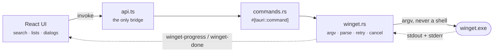

<div align="center">


# Wingman

**A friendly desktop front-end for the Windows Package Manager.**

Search the winget catalogue, install and remove software, and keep everything
up to date — without opening a terminal.

[](LICENSE)
[](#requirements)
[](https://tauri.app/)
[](https://rustup.rs/)
[](https://github.com/Rakjsu/Wingman/actions)

</div>

---

## Contents

- [Why Wingman](#why-wingman)
- [Features](#features)
- [Screenshots](#screenshots)
- [Install](#install)
- [Requirements](#requirements)
- [Build from source](#build-from-source)
- [How it works](#how-it-works)
- [Project layout](#project-layout)
- [Keyboard shortcuts](#keyboard-shortcuts)
- [Where your data lives](#where-your-data-lives)
- [Troubleshooting](#troubleshooting)
- [Contributing](#contributing)
- [Roadmap](#roadmap)
- [License](#license)

---

## Why Wingman

`winget` is excellent and ships with Windows, but it is a command line. Wingman
keeps everything that makes winget good — the official catalogue, silent
installs, no bundled adware — and puts a real interface on top:

|                          | `winget` CLI               | Wingman                                   |
| ------------------------ | -------------------------- | ----------------------------------------- |
| Browse the catalogue     | type exact queries         | search-as-you-type, curated categories    |
| See what needs an update | run a command              | a live badge in the sidebar               |
| Update everything        | one command, no preview    | preview the list, pin what to skip        |
| A failed install         | a hex error code           | a sentence, and the action that fixes it  |
| Needs administrator      | rerun in an elevated shell | offers to relaunch itself                 |
| Long install             | watch the terminal         | progress bar, cancellable, logged to disk |

Wingman is a front-end, not a replacement: everything it does is a winget
invocation you could have typed yourself.

## Features

**Finding software**

- Search-as-you-type across the winget catalogue, debounced and cached
- Curated picks grouped by category (browsers, development, media, productivity, communication)
- Filter by source (`winget` or `msstore`)
- Star packages to keep them at the top

**Managing what you have**

- Filter and sort the installed list by name, identifier or source
- Select several packages and remove them in one go
- **Deep-clean uninstall** — after the uninstaller runs, Wingman finds the
  folders, registry keys, autostart entries and shortcuts it left behind and
  offers them for removal. Everything is previewed first, folders go to the
  Recycle Bin, and registry keys are backed up to a `.reg` file before deletion
- Package details: publisher, licence, description, homepage, and every installable version
- Export your package list and import it on another machine

**Staying current**

- Sidebar badge showing how many updates are waiting
- Update one package or all of them, with a preview of exactly what will change
- Pin a package to keep "Update all" away from it
- A background check every six hours with a native notification

**While it runs**

- A real progress bar, read from winget's own output
- Cancel any operation — Wingman kills the whole process tree, not just winget
- A live activity log you can copy, plus daily rotated logs on disk
- Failures explain themselves, and offer to relaunch as administrator when that is the actual problem

**The details**

- Light, dark, or follow-the-system theme
- English, Portuguese and Spanish, detected from your system
- Keyboard-driven, screen-reader labelled, and checked against `axe`
- One instance only — a second launch focuses the window you already have

## Screenshots

> **Note**
> Screenshots are not in the repository yet. Run `npm run tauri dev`, capture the
> Discover, Installed and Updates sections, and drop the files into
> `docs/screenshots/` — this section links to them.

## Install

**From a release**

Grab the latest `.msi` from the [Releases page](https://github.com/Rakjsu/Wingman/releases)
and run it.

> Releases are not code-signed yet, so SmartScreen will warn on first run.
> Choose **More info → Run anyway**, or build it yourself from source below.

**From winget itself** (once the manifest is published)

```powershell
winget install Rakjsu.Wingman
```

## Requirements

| Requirement | Minimum                                                                      |
| ----------- | ---------------------------------------------------------------------------- |
| Windows     | 10 (1809) or 11                                                              |
| winget      | 1.6 — ships as "App Installer" from the Microsoft Store                      |
| WebView2    | Preinstalled on Windows 11; installed by the Wingman installer on Windows 10 |

Wingman checks all of this at startup and walks you through anything missing.

## Build from source

**Prerequisites**

- [Rust](https://rustup.rs/) 1.82+ with the MSVC toolchain
- [Node.js](https://nodejs.org/) 20 LTS or newer
- [Microsoft C++ Build Tools](https://visualstudio.microsoft.com/visual-cpp-build-tools/) with the "Desktop development with C++" workload

**Run it**

```powershell
git clone https://github.com/Rakjsu/Wingman.git
cd Wingman
npm install
npm run tauri dev
```

> **Warning**
> Do not double-click the executable in `src-tauri/target/debug/`. Debug builds
> load their interface from the Vite dev server on port 1420, so without
> `tauri dev` running you get a blank window — or, if another Vite project holds
> that port, _that_ project's interface. Use `npm run tauri dev` while developing
> and `npm run tauri build` for anything you actually want to run.

**Build installers**

```powershell
npm run tauri build
```

Produces a standalone `Wingman.exe` plus `.msi` and `.exe` installers under
`src-tauri/target/release/bundle/`.

## How it works

Wingman is a thin, careful shell around the `winget` executable. The frontend
never touches a shell; it can only call the commands the Rust layer exposes.



A few decisions worth knowing about:

- **Arguments, never a shell.** Package identifiers are passed as separate argv
  entries and validated first, so nothing a package is named can turn into a
  command.
- **One operation at a time.** winget takes an exclusive lock on its package
  source, so everything you start is queued and run in order rather than fired
  in parallel.
- **Errors are typed.** winget's exit codes are mapped onto a Rust enum, which is
  what lets the interface offer "restart as administrator" instead of printing
  `0x8A150019`.
- **Output parsing is defensive.** winget's tables are aligned by _display_
  width, its progress bar rewrites lines with carriage returns, and some shells
  hand back UTF-16. The parser handles all three, and a property test keeps it
  from panicking on anything unexpected.
- **No structured output exists.** `winget search --output json` is not a thing
  (checked against 1.29). Parsing the table is currently the only option; the
  `Backend` enum is the seam where a COM implementation will plug in.

More detail in [docs/ARCHITECTURE.md](docs/ARCHITECTURE.md).

## Project layout

```
Wingman/
├── src/                        # React frontend
│   ├── components/             # Sidebar, PackageList, dialogs, …
│   ├── hooks/                  # events, queue, storage, theme, toasts
│   ├── lib/                    # api bridge, error mapping, shared types
│   ├── data/featured.ts        # curated catalogue
│   ├── i18n.ts                 # en / pt / es, plurals, dates, collation
│   └── App.tsx                 # sections and orchestration
├── src-tauri/                  # Rust backend
│   ├── src/winget.rs           # process wrapper, parser, cancellation
│   ├── src/commands.rs         # the command surface
│   ├── src/error.rs            # exit codes → typed errors
│   ├── src/logging.rs          # rotated file logs
│   └── tests/integration.rs    # runs against a real winget
└── .github/workflows/ci.yml    # lint, types, tests, clippy, audit, release
```

## Keyboard shortcuts

| Keys           | Action                                   |
| -------------- | ---------------------------------------- |
| `Ctrl` `F`     | Focus search                             |
| `Ctrl` `K`     | Focus search                             |
| `Ctrl` `1`–`4` | Discover / Installed / Updates / History |
| `Esc`          | Close a dialog, dismiss an error         |
| `?`            | Show the shortcut list                   |

## Where your data lives

Wingman keeps everything on your machine and sends nothing anywhere.

| What                                        | Where                                    |
| ------------------------------------------- | ---------------------------------------- |
| Logs (daily, kept 14 days)                  | `%LOCALAPPDATA%\Wingman\logs`            |
| Registry backups from deep-clean uninstalls | `%LOCALAPPDATA%\Wingman\backups`         |
| Theme, language, favorites, pins, history   | Browser local storage inside the app     |
| Window size and position                    | Managed by the Tauri window-state plugin |

There is no telemetry, no account, and no network traffic beyond what winget
itself makes to fetch packages.

## Troubleshooting

**"winget is required" on a machine that has winget.**
Wingman needs 1.6 or newer. Update "App Installer" from the Microsoft Store.

**An install fails with an administrator error.**
Accept the "Restart as administrator" prompt. Some packages write to locations a
normal user cannot touch.

**"winget is busy with another operation."**
Something else — Windows Update, another winget window, or a second copy of
Wingman — holds the source lock. Wingman retries automatically; if it persists,
close the other one.

**An operation appears stuck.**
Press Cancel; the whole process tree is killed. Anything silent for 30 minutes is
stopped automatically. The activity log and `%LOCALAPPDATA%\Wingman\logs` have
the details.

## Contributing

Contributions are welcome. [CONTRIBUTING.md](CONTRIBUTING.md) covers the dev
setup, the checks CI runs, and how to add a translation (it is one file). By
taking part you agree to the [Code of Conduct](CODE_OF_CONDUCT.md).

Found a security issue? Please follow [SECURITY.md](SECURITY.md) instead of
opening a public issue.

## Roadmap

Tracked in [CHANGELOG.md](CHANGELOG.md#unreleased). The headline items:

- Drive winget through its COM API instead of parsing console output
- Code-signed installers
- In-app updates
- A published `winget-pkgs` manifest, so you can install Wingman with winget

## License

[MIT](LICENSE) © 2026 Rakjsu

Wingman is an independent project. `winget`, Windows and Microsoft Store are
trademarks of Microsoft Corporation; Wingman is not affiliated with or endorsed
by Microsoft.
