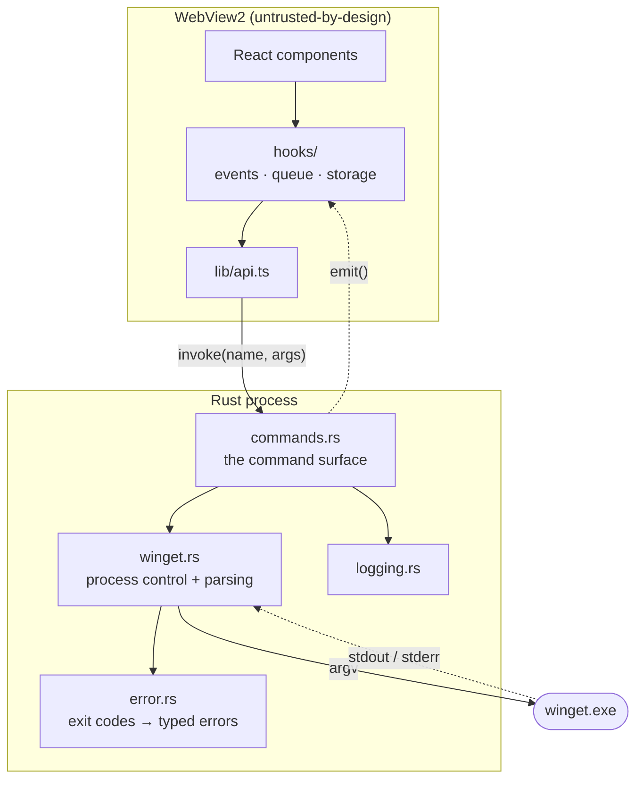

# Architecture

How Wingman is put together, and why it is put together that way.

## The shape of it

Wingman is a [Tauri 2](https://tauri.app/) application: a Rust process that owns
a WebView2 window. The interface is React; the privileged work is Rust. They talk
over Tauri's IPC and nothing else.



The frontend has no shell access, no filesystem access, and no network access
(the CSP forbids it). Every capability it has is a named command in
`commands.rs`. Adding a capability means adding a command — which is the point.

## Why an enum instead of a trait

`winget.rs` exposes a `Backend` enum with one variant today (`Cli`). The obvious
Rust idiom would be a `PackageSource` trait, but async trait objects need an
extra dependency, and the seam only ever has one implementation live at a time.
An enum keeps the dispatch honest and the dependency list short. When the COM
backend lands it becomes a second variant; no call site changes.

## Talking to winget

### Invocation

Every call goes through `base_command()`, which pipes stdout and stderr and sets
`CREATE_NO_WINDOW` so console windows never flash behind the interface.
Arguments are always separate argv entries. There is no shell anywhere in the
path, and `validate_id` rejects identifiers that start with `-` before they can
be read as flags.

### Reading the output

winget's table output is harder to parse than it looks:

1. **Columns are aligned by display width, not character count.** A CJK name
   occupies two terminal columns per character. Slicing by character index eats
   one character per wide glyph — which is exactly the bug the `handles_cjk_names`
   test was written to catch. `slice_cols` walks the string accumulating
   `unicode-width` instead.

2. **The dashed separator carries no column information.** It is one continuous
   run of dashes, so splitting it yields a single column. Boundaries come from
   the positions of the known header labels instead.

3. **The progress bar rewrites lines with `\r`.** A whole spinner animation, and
   sometimes the header itself, can arrive as one logical line. Everything is
   split on both `\r` and `\n` before parsing.

4. **Some shells return UTF-16 with a BOM.** `decode` sniffs the BOM and falls
   back to UTF-8.

A `proptest` case throws arbitrary strings at the parser and asserts it neither
panics nor produces a row without an identifier.

### There is no JSON

`winget search --output json` does not exist — verified against winget 1.29.290,
which answers `Argument name was not recognized for the current command`. Only
`winget export` emits JSON, and only for the installed list. Parsing the table is
the only route to search results today; the COM API is the way out, and the
`Backend` enum is where it will attach.

## Long-running operations

Installs stream rather than block:

```
run_action
  ├── spawn winget, register its pid
  ├── stdout reader ─┐
  │                  ├─→ mpsc channel ─→ progress callback ─→ emit("winget-progress")
  ├── stderr reader ─┘
  ├── idle watchdog: 30 minutes with no output at all → kill
  └── wait() → exit code → typed error or Ok
```

Both streams feed one channel so ordering stays roughly chronological and a
chatty stderr cannot deadlock a full stdout pipe.

### Cancellation

`OpRegistry` maps operation ids to process ids. Cancelling removes the entry and
runs `taskkill /F /T`, killing the *tree* — winget launches the real installer as
a child, so killing winget alone leaves the installer running. The same registry
is drained when the window closes, for the same reason.

`cancel` is an `async` command deliberately: synchronous Tauri commands run on
the main thread, and a blocking `taskkill` there freezes the window.

### One at a time

winget takes an exclusive lock on its package source. Two operations at once make
each other fail with `0x8A150049`. The frontend's `useOperationQueue` serialises
everything the user starts; the backend's `run_capture_retrying` adds backoff for
the case where something *outside* Wingman holds the lock.

This is also why `cargo test --test integration` needs `--test-threads=1`.

## Errors

`error.rs` maps winget's exit codes onto variants that imply an action:

| Exit code    | Variant           | What the UI does                |
| ------------ | ----------------- | ------------------------------- |
| `0x8A150019` | `NeedsElevation`  | offers to relaunch as admin     |
| `0x8A150014` | `NotFound`        | shows an empty result, not an error |
| `0x8A150049` | `SourceBusy`      | retries, then suggests waiting  |
| `0x8A150011` | `HashMismatch`    | reports that nothing was run    |
| `0x8A150023` | `Cancelled`       | a quiet toast                   |

Exit codes are not always populated, so the mapper also sniffs stderr for the
cases users actually hit. The enum is serialised with
`#[serde(tag = "kind", content = "detail")]`, and `lib/types.ts` mirrors it —
keeping the two in step is manual, and the type checker catches drift at the use
sites.

## Frontend notes

**Events.** `useWingetEvents` tracks a `disposed` flag because `listen()` resolves
*after* the effect's cleanup runs under StrictMode. Without it the first
subscription leaks and every event arrives twice — which is exactly the duplicate
log bug that shipped in the MVP. There is a regression test.

**Identity discipline.** `useStringSet` memoises its `Set`. Rebuilding it each
render gives it a new identity, which cascades into new `rowState` callbacks and
quietly defeats the `memo` on every row.

**Virtualisation.** Lists over 40 rows render through `@tanstack/react-virtual`.
Because only a slice is in the DOM, the wrapper elements carry `aria-posinset`
and `aria-setsize` so assistive tech reports the real position. Those attributes
belong on the element with the `listitem` role, not on the row itself — putting
them on a plain `div` is an `aria-allowed-attr` violation, which the `axe` test
now catches.

**Language.** `t()` is a plain function reading module state, not a hook. Changing
language calls `setLang` and remounts the tree via a `key`. Cheap, and it avoids
threading a context through every component. The cost is that tests must reset
the language between cases.

## Security posture

- **CSP is explicit and split.** Stylesheets must come from the bundle
  (`style-src-elem 'self'`), while `style-src-attr 'unsafe-inline'` is
  unavoidable: React and the virtualiser set element styles through the `style`
  attribute. `connect-src` allows only Tauri's own IPC origin, so the interface
  cannot reach the network at all.
- **Capabilities are enumerated.** `capabilities/default.json` lists individual
  permissions rather than whole plugins.
- **No inline shell.** `relaunch_elevated` binds the executable path as a
  PowerShell *argument* rather than interpolating it into the script body.
- **Only http(s) links open.** `open_url` refuses every other scheme.

## Testing

| Layer                | Where                          | Runs in CI |
| -------------------- | ------------------------------ | ---------- |
| Parser, registry, errors | `src-tauri/src/**` unit tests | yes |
| Property tests       | `proptest` in `winget.rs`      | yes |
| Live winget          | `src-tauri/tests/integration.rs` | no — `#[ignore]`, needs winget |
| Components           | `src/**/*.test.tsx`            | yes |
| Whole app            | `src/App.test.tsx`             | yes |
| Accessibility        | `src/a11y.test.tsx` via `axe-core` | yes |
| Translations         | `src/i18n.test.ts` — key parity, placeholders, plurals | yes |

Coverage thresholds are a ratchet set just under current numbers: they exist to
stop coverage sliding backwards, not to describe a goal.
